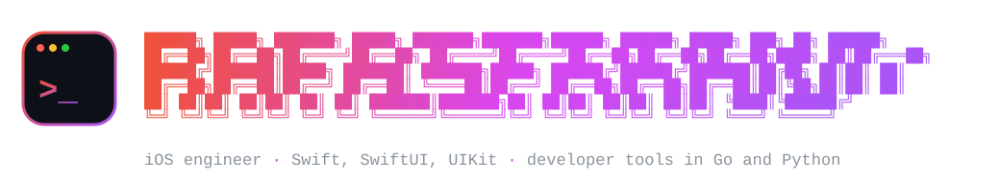

<p align="center">
  
</p>

<p align="center">
  <a href="https://www.linkedin.com/in/rafaelserranogamarra"></a>
  <a href="mailto:rafasrrg13@gmail.com"></a>
  
</p>

iOS engineer on the Zara app, a single app that serves every market. I've worked on it since 2023 at Nomasystems, mostly in Swift, SwiftUI and UIKit. Before that I was an Oracle DBA.

What pulls me in is how an app is put together: how it's split into modules, how it's tested and how its pieces depend on each other. Outside work I build developer tools in Go and Python, and an iOS app of my own. I ship them the way I'd want to receive them: CI on every pull request, tagged releases with a changelog, Homebrew formulae, and an `AGENTS.md` in each repository so coding agents start with the context they need.

## What I work on

- In-store features: appointment booking, orders destined for a store, and finding an item on the shop floor or in the stockroom.
- As part of the team, moving a monolithic codebase to Domain / Network / Presentation layers in Swift Package Manager modules, with unit tests on use cases, mappers and view models.
- Migrating legacy UIKit screens to SwiftUI and removing hidden dependencies on the way.
- Live Activities updated through push notifications, Apple Wallet passes, Quick Actions and accessibility work (Dynamic Type included).
- AI in the development workflow: module READMEs and `AGENTS.md` files so coding agents get context they can actually use.

That code lives in private repositories. The projects below are personal.

## Projects

### [minimal](https://github.com/RafaSG13/Minimal) · a coding-agent harness for the terminal

<p align="center">
  <a href="https://github.com/RafaSG13/Minimal"></a>
</p>

<p align="center">
  <a href="https://pypi.org/project/mnml-agent/"></a>
  
  
</p>

A small agent loop (model → tools → model) with a Textual UI, written so that every piece can be read in one sitting and replaced from a single Python file. Works with Claude, Gemini and any OpenAI-compatible server (OpenAI, OpenRouter, Ollama, LM Studio) on one provider-neutral history, so you can switch provider mid-conversation.

- Tools, slash commands, providers, hooks, panels, themes and modes are all extensions. The model knows the API: it writes its own, hot-reloads them and uses them in the same turn.
- Sub-agents with their own tools, model and provider, tracked by agent id; modes restrict which tools the model may use (a plan/build pair ships in the marketplace).
- Safe by default: confirmations, allow/deny permission rules, a project's extensions run only after `/trust`, global installs show a static scan of the code first, and edits are refused on files that changed since the model read them.
- [minimal-marketplace](https://github.com/RafaSG13/minimal-marketplace): the default git-based marketplace, with 50 extensions, tools, widgets and themes, versioned by extension API and checked in CI against every change to minimal.

```bash
uv tool install mnml-agent        # or: brew install rafasg13/tap/minimal
```

### [Pandora](https://github.com/RafaSG13/Pandora) · a terminal vault for secrets

<p align="center">
  <a href="https://github.com/RafaSG13/Pandora"></a>
</p>

<p align="center">
  <a href="https://github.com/RafaSG13/Pandora/releases"></a>
  
  
</p>

A full-screen TUI plus a scriptable CLI that keep API keys, tokens and passwords out of dotfiles and shell history.

- Master-password vault: names, notes and values encrypted with Argon2id and XChaCha20-Poly1305; values also kept in the OS keyring (macOS Keychain, Windows Credential Manager, Linux Secret Service) under random IDs.
- `get`, `add`, `run` (injects secrets into one process only), `gen`, encrypted `export`/`import` with age, tags and multi-line secrets such as SSH keys.
- A clipboard that clears itself after 15 seconds and is kept out of clipboard history on macOS and Windows, an idle lock that drops the key from memory, and safe concurrent writes from several processes.
- No network, no telemetry. Releases with checksums and a written threat model.

```bash
brew install rafasg13/tap/pandora
```

### [Messup](https://github.com/RafaSG13/ios-messup) · personal finance for iOS 26

<p align="center">
  <a href="https://github.com/RafaSG13/ios-messup"></a>
</p>

<p align="center">
  
  
  
</p>

Expense, income and savings tracker, my university final project rebuilt as a local-only app: no backend, no login, no third-party dependencies.

- SwiftUI with Liquid Glass, SwiftData on device, Swift 6 language mode; Model-View with `@Observable` services injected through the environment.
- Monthly and per-category budgets with notifications at 80 % and 100 %, period comparisons with projections, spending insights and CSV export.
- An App Intent to log an expense from Siri, Shortcuts, Spotlight or the Action button.
- Shared components in a local SPM design-system package; logic covered with Swift Testing.

### [NavigatorUI](https://github.com/RafaSG13/NavigatorUI) · navigation for SwiftUI

<p>
  
  
</p>

Lightweight navigation library inspired by `UINavigationController`, with deep linking and modular destinations.

## Stack

<p align="center">
  
</p>

**iOS:** Swift · SwiftUI · UIKit · SwiftData · Swift Concurrency · Swift Package Manager · Swift Testing · XCTest · App Intents · Live Activities · PassKit · Accessibility

**Tooling:** Go · Python · Textual · Bubble Tea · uv · GoReleaser · GitHub Actions · Homebrew

## Contact

I'm looking for iOS roles at product companies, ideally fully remote and international. Reach me on [LinkedIn](https://www.linkedin.com/in/rafaelserranogamarra) or at rafasrrg13@gmail.com.
